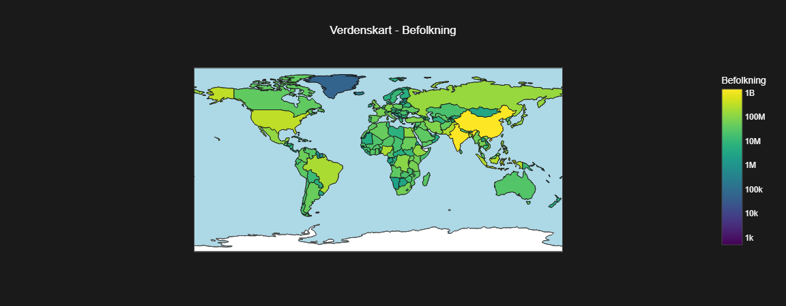

# Verdens befolkning – interaktivt dashboard

En nettapp som visualiserer befolkningsutviklingen i alle verdens land fra 1970 til 2023. Velg et land eller et kontinent og se befolkningen på et interaktivt verdenskart eller som en vekstkurve over tid.

Appen består av en **Flask-backend** som behandler datasettet med pandas og leverer det som et REST-API, og en **React/TypeScript-frontend** som henter dataene og viser dem med Plotly.

<p align="center">
  
</p>

## Funksjoner

- **Verdenskart** (koropletkart) over befolkningen i 2023, med eksakte tall når du holder musen over et land. Fargene følger en logaritmisk skala, slik at forskjellene mellom små land synes like godt som mellom de største
- **Kontinentkart** som zoomer inn på ett kontinent
- **Vekstkurver** for befolkningen i et valgt land fra 1970 til 2023
- **Sammenligning av kontinenter** over tid
- **Filtrering:** velg kontinent, og landlisten viser bare landene i det kontinentet

## Arkitektur

```
React-frontend (Vite, port 5173)  ──HTTP/JSON──►  Flask-backend (port 5000)  ──►  world_population_data.csv
```

**Databehandling i backend.** CSV-filen har én rad per land og én kolonne per år. Ved oppstart gjøres den om til langt format (én rad per land og år) med `melt`. API-et filtrerer og aggregerer deretter etter land, kontinent og år.

| Endepunkt | Parametere | Returnerer |
| --- | --- | --- |
| `/get_population_data` | – | Befolkning per land i 2023 |
| `/get_country_population_data` | `continent` | Befolkning per land i et kontinent, 2023 |
| `/country_growth` | `country` | Befolkning i et land for hvert år |
| `/continent_growth` | – | Total befolkning per kontinent for hvert år |

## Teknologi

- **Backend:** Python, Flask, pandas, Flask-CORS
- **Frontend:** React 18, TypeScript, Vite, Plotly (`react-plotly.js`), axios, SCSS-moduler

## Filer

```
├── backend/
│   ├── server.py                  # Flask-API og databehandling
│   ├── requirements.txt
│   └── world_population_data.csv
├── frontend/
│   └── src/
│       ├── App.tsx                # hovedkomponent og valg av visning
│       ├── api.ts                 # adressen til backend og årstallene
│       ├── plotStyle.ts           # felles utseende for grafene
│       └── components/            # kart, vekstkurver, valgmenyer og lysbildevisning
├── flowchart.drawio               # flytskjema for appen
└── gui.drawio                     # skisse av brukergrensesnittet
```

## Kjøring

Start backend i én terminal:

```bash
cd backend
pip install -r requirements.txt
python server.py
```

Start frontend i en annen terminal:

```bash
cd frontend
npm install
npm run dev
```

Åpne http://localhost:5173 i nettleseren.

## Data

Befolkningstall for 234 land for årene 1970, 1980, 1990, 2000, 2010, 2015, 2020, 2022 og 2023, med areal, befolkningstetthet og vekstrate. 

## Forfatter

Eirik Aarrestad – bachelor i statistikk og data science, UiB
